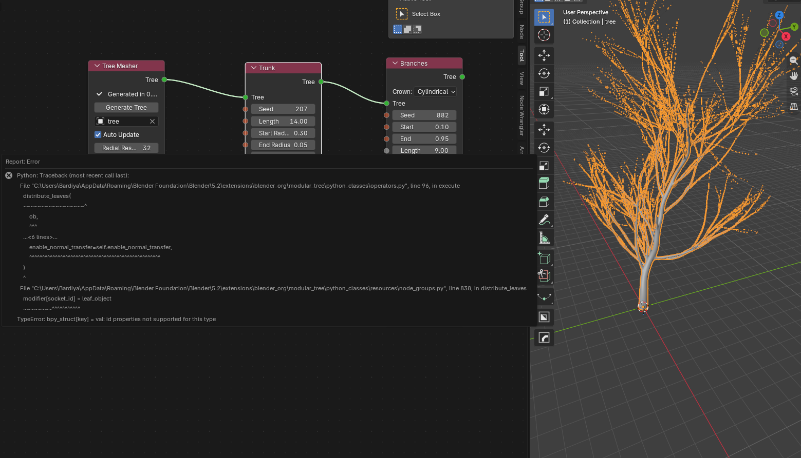
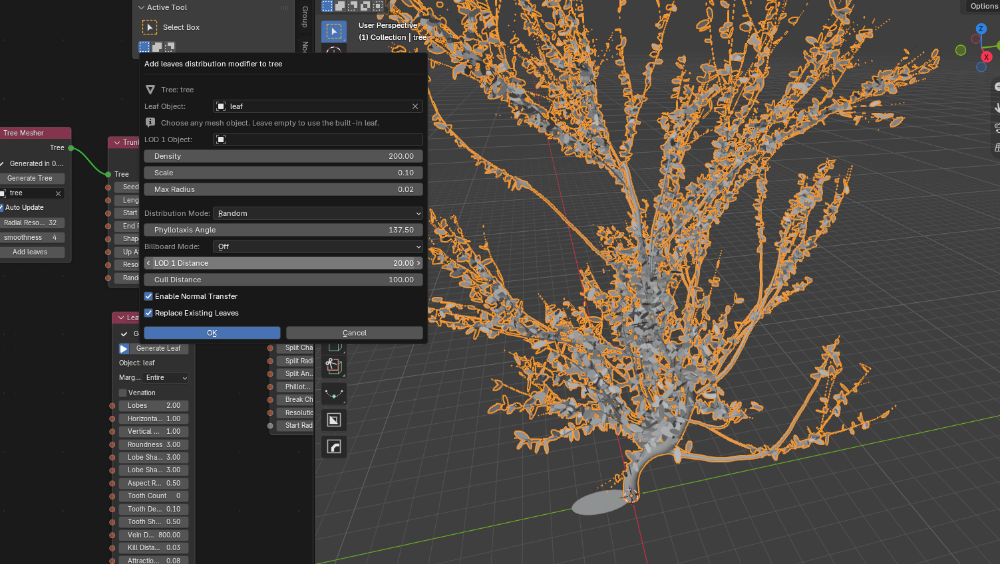

# Modular-Tree-Blender-5.2-Fix
Compatibility fix for the [Modular Tree add-on](https://github.com/GoodPie/modular_tree) in Blender 5.2 LTS, restoring the **Add Leaves** button in the MTree node editor.

# Modular Tree Fix for Blender 5.2 LTS

This repository provides a compatibility fix for the Modular Tree add-on in Blender 5.2 LTS.

## Problem

In Blender 5.2 LTS, clicking **Add Leaves** in the MTree node editor may fail because of an incompatibility with Blender's API.

## Installation

1. Install Modular Tree through Blender's **Get Extensions** interface.
2. Locate the installed add-on files. Usually at this path (replace the brackets with your own username and Blender Version): C:\Users\\[USER]\AppData\Roaming\Blender Foundation\Blender\\[Version]\extensions\blender_org\
3. Back up the original files before replacing them.
4. Replace the corresponding files with the fixed versions provided in this repository. [operators.py](operators.py) in \modular_tree\python_classes and [node_groups.py](node_groups.py) in \modular_tree\python_classes\resources
5. Restart Blender and test the Add Leaves button.

## Video Tutorial

Watch the video for a step-by-step guide to fixing the Add Leaves error in Blender 5.2 LTS.

## Original Project

- **Original repository:** [GoodPie/modular_tree](https://github.com/GoodPie/modular_tree)
- **Original author:** [Maxime Herpin](https://github.com/MaximeHerpin/modular_tree)
- **Maintained fork:** GoodPie
- **License:** GPL-3.0

## Important

This repository contains modified files for compatibility with Blender 5.2 LTS. Install the original [Modular Tree add-on](https://extensions.blender.org/add-ons/modular-tree/) separately.

This is an unofficial community fix and is not an official Blender release.
